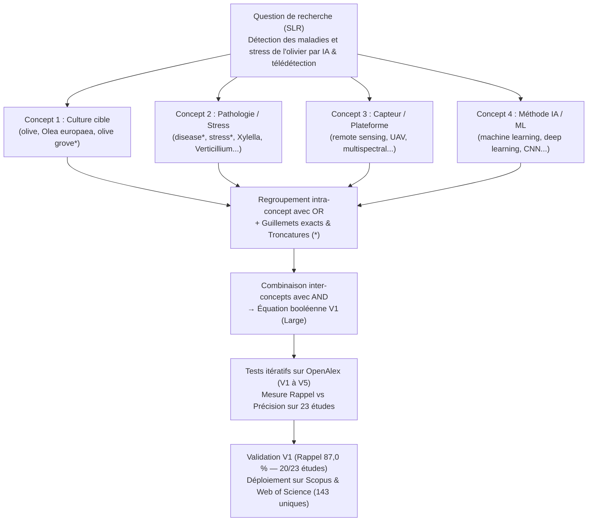

# Lab 3 — Stratégie de recherche bibliographique reproductible

**Revue systématique :** *Machine learning and remote sensing for disease and stress detection in olive* (PRISMA 2020 / PRISMA-S)
**Bases de la SLR :** Scopus, Web of Science Core Collection (recherche du 15/11/2026)
**Base des tests du lab :** OpenAlex (gratuite, sans compte), car aucun accès institutionnel à Scopus ni à WoS n'est disponible pour refaire les tests
**Date de la recherche :** 15 novembre 2026
**Résultat :** 215 enregistrements → 143 uniques → 23 rapports (22 études) inclus

Ce dépôt documente la construction, le test et la justification de la requête utilisée dans la revue, en suivant les 15 étapes du Lab 3.


## En bref

**Technologies.** Les requêtes sont écrites dans le **langage de recherche booléen** propre à chaque base : `TITLE-ABS-KEY()` pour Scopus, `TS=()` pour WoS, `title_and_abstract.search` pour OpenAlex, `"All Metadata":` pour IEEE Xplore. Ce n'est **pas du SQL** : aucune base de données relationnelle n'est interrogée et le lab ne demande pas de SQL. **Python 3** (bibliothèque standard uniquement) sert à exécuter les requêtes dans OpenAlex, à mesurer le rappel et la précision, et à tester automatiquement la cohérence des requêtes.

**Résultats clés** (OpenAlex, 24/11/2026 ; référence : les 23 rapports inclus dans la SLR) :

| Version | Résultats uniques | Pertinents dans les 10 premiers | Rapports inclus retrouvés | Précision |
|---|---:|---:|---:|---:|
| **V1 large (retenue)** | 139 | 9/10 | **20/23** | 14,4 % |
| V2 intermédiaire | 83 | 9/10 | 15/23 | 18,1 % |
| V3 restrictive | 45 | 6/10 | 9/23 | 20,0 % |
| V4 enrichie | 140 | – | 20/23 | 14,3 % |
| V5 avec NOT | 129 | – | 19/23 | 14,7 % |

Conclusion : les versions plus étroites gagnent au plus 5,6 points de précision mais perdent 5 à 11 rapports inclus. NOT fait perdre une étude incluse. Les synonymes supplémentaires n'apportent rien. **V1 est retenue.**

**Correspondance étapes → fichiers**

| Étape du lab | Section | Fichiers |
|---|---|---|
| 1–3 Question et concepts | §1–3 | `README.md` |
| 4 Mots-clés et synonymes | §4 | `search/keywords_table.csv` |
| 5–8 Booléens, guillemets, troncatures, groupes | §5–8 | `search/queries_*.txt`, `search/queries_openalex.json`, `tests/test_queries.py` |
| 9 Requête V1 | §9 | `search/queries_scopus.txt`, `search/queries_wos.txt` |
| 10 Test de la requête | §10 | `scripts/openalex_search.py`, `results/top10_relevance.csv`, `results/recall_results.csv` |
| 11 Versions intermédiaire et restrictive | §11 | `exports/V1…V5/`, `scripts/recall_check.py`, `results/missed_reports.csv`, `results/new_vs_V1.csv` |
| 12 Choix final et justification | §12 | `README.md` |
| 13 Adaptation aux bases | §13 | `search/queries_scopus.txt`, `search/queries_wos.txt`, `search/queries_openalex.json`, `search/queries_ieee_acm.txt` |
| 14 Documentation et reproductibilité | §14 | `search/search_log.csv`, `search/openalex_run_log.csv` |
| 15 Questions et défis | §15 | `README.md` |

**Exécuter**

```bash
python -m unittest discover -s tests -v                     # 17 tests, sans connexion internet
python scripts/openalex_search.py --mailto ton@email.org    # relance les 5 requêtes dans OpenAlex
python scripts/recall_check.py                              # recalcule rappel, précision et rapports manqués
```

Les tests vérifient : les parenthèses et guillemets équilibrés, les opérateurs en majuscules, les 4 concepts reliés par AND, que V2 et V3 sont strictement incluses dans V1, que V4 contient V1, que V5 est V1 + NOT, que V1 est identique dans Scopus et WoS, la normalisation des DOI et titres, le calcul du rappel et de la précision sur des données fictives, la construction des URL OpenAlex et la cohérence des résultats publiés. Ils sont exécutés automatiquement par GitHub Actions à chaque envoi (`.github/workflows/tests.yml`).

## Architecture du projet & Flux méthodologique (PRISMA-S)

### Arborescence du dépôt

```text
PRISMA2020-Lab3/
├── README.md                        # Rapport méthodologique complet (Étapes 1 à 15)
├── data/
│   └── included_reports.csv         # Jeu de référence : 23 rapports inclus (22 études SLR)
├── search/
│   ├── keywords_table.csv           # Matrice Concepts → Mots-clés → Synonymes → Variantes
│   ├── queries_scopus.txt           # Syntaxe Scopus (TITLE-ABS-KEY, V1–V5)
│   ├── queries_wos.txt              # Syntaxe Web of Science Core Collection (TS=, V1–V5)
│   ├── queries_ieee_acm.txt         # Adaptation IEEE Xplore & ACM Digital Library
│   ├── queries_openalex.json        # Requêtes structurées pour l'API OpenAlex (V1–V5)
│   ├── search_log.csv               # Journal officiel PRISMA-S (Scopus & WoS)
│   └── openalex_run_log.csv         # Journal d'exécution automatisée (dates, URL, volumes)
├── scripts/
│   ├── openalex_search.py           # Interrogation reproductible de l'API OpenAlex (Python 3)
│   └── recall_check.py              # Évaluation du rappel, de la précision et des études manquées
├── exports/
│   ├── V1_large/openalex.csv        # Export brut V1 (139 résultats — retenue)
│   ├── V2_intermediaire/openalex.csv# Export brut V2 (83 résultats)
│   ├── V3_restrictive/openalex.csv  # Export brut V3 (45 résultats)
│   ├── V4_enrichie/openalex.csv     # Export brut V4 (140 résultats)
│   └── V5_test_NOT/openalex.csv     # Export brut V5 avec exclusion NOT (129 résultats)
├── results/
│   ├── recall_results.csv           # Synthèse comparative des métriques par version
│   ├── missed_reports.csv           # Analyse des faux négatifs par version
│   ├── new_vs_V1.csv                # Gain marginal de la version enrichie V4
│   └── top10_relevance.csv          # Évaluation manuelle de pertinence (Top 10)
└── tests/
    ├── test_queries.py              # Validation syntaxique et booléenne des requêtes
    ├── test_openalex_search.py      # Tests unitaires du client API OpenAlex
    └── test_recall_check.py         # Tests unitaires du calcul de rappel/précision
```

### Pipeline de construction et de validation de la requête



## Contenu du dépôt

| Fichier | Rôle |
|---|---|
| `README.md` | Rapport du lab (ce document) |
| `search/keywords_table.csv` | Tableau concepts → mots-clés → synonymes → variantes (étape 4) |
| `search/queries_scopus.txt` | Requête V1 telle qu'exécutée dans Scopus (+ V2–V5 traduites, non exécutées) |
| `search/queries_wos.txt` | Requête V1 telle qu'exécutée dans WoS (+ V2–V5 traduites, non exécutées) |
| `search/queries_openalex.json` | Requêtes V1 à V5 en syntaxe OpenAlex (base des tests) |
| `search/openalex_run_log.csv` | Créé par le script : date, nombre de résultats et URL exacte de chaque exécution |
| `search/queries_ieee_acm.txt` | Adaptation de V1 à IEEE Xplore et ACM DL (étape 13) |
| `search/search_log.csv` | Journal de recherche : base, date, champ, filtres, résultats, rappel, précision |
| `data/included_reports.csv` | Les 23 rapports inclus dans la SLR (jeu de référence pour tester les requêtes) |
| `scripts/openalex_search.py` | Exécute V1 à V5 dans OpenAlex et enregistre les résultats |
| `scripts/recall_check.py` | Calcule résultats, rappel et précision de chaque version à partir des exports |
| `exports/V1_large/` … `exports/V5_test_NOT/` | Résultats bruts de chaque version dans OpenAlex (DOI, titre, année ; données CC0) |
| `results/recall_results.csv` | Résultats, rapports inclus retrouvés, rappel et précision par version |
| `results/missed_reports.csv` | Rapports inclus manqués par chaque version |
| `results/new_vs_V1.csv` | Enregistrements d'une version absents de V1 |
| `results/top10_relevance.csv` | Pertinence des 10 premiers résultats de V1, V2 et V3 (étape 10), avec la source du jugement |
| `tests/` | Tests automatiques (`python -m unittest discover -s tests`) |
| `.github/workflows/tests.yml` | Exécution automatique des tests sur GitHub |
| `exports/README.md` | Organisation des exports |

---

## 1. Introduction et prérequis

La recherche alimente une revue systématique ; elle doit donc être **exhaustive** (ne pas manquer d'étude pertinente) et **reproductible** (un autre chercheur doit obtenir les mêmes résultats). Elle est rapportée selon PRISMA 2020 et son extension PRISMA-S. Le protocole (questions de recherche, bases, requêtes, critères d'éligibilité) a été fixé le 15/11/2026, avant le tri.

Outils : Scopus et Web of Science pour la recherche de la SLR ; **OpenAlex** (API ouverte, gratuite, sans compte) pour les tests du lab, faute d'accès institutionnel à Scopus et WoS ; Python 3 (bibliothèque standard) pour l'exécution des requêtes, le dédoublonnage et le test de rappel.

## 2. Analyse de la question de recherche

Question générale : *quelles combinaisons de plateformes, capteurs, cibles et algorithmes d'apprentissage automatique ont été utilisées pour détecter les maladies et les stress de l'olivier par télédétection, et quelle est la fiabilité des preuves ?*

Elle est déclinée en cinq questions (RQ1 caractéristiques des études et détection précoce ; RQ2 plateformes, modalités et fusion ; RQ3 méthodes d'IA et explicabilité ; RQ4 performances, validation et biais ; RQ5 maturité opérationnelle).

```
Question de recherche
        ↓
4 concepts (culture, plateforme/capteur, cible, méthode)
        ↓
Mots-clés + synonymes + troncatures
        ↓
Groupes avec OR
        ↓
Combinaison avec AND  →  requête V1
        ↓
Test, variantes V2–V5, choix final, documentation
```

## 3. Identification des concepts principaux

| Concept | Ce qu'il couvre | Ce qu'il ne couvre pas |
|---|---|---|
| **C1 Culture** | L'olivier, le verger, l'oliveraie | Les autres cultures, l'huile d'olive comme produit |
| **C2 Plateforme et capteur** | Drone (UAV), avion, satellite ; capteurs multi/hyperspectraux, thermiques, LiDAR | Capteurs portatifs, laboratoire, images de feuilles |
| **C3 Cible** | Maladies (*Xylella*, *Verticillium*, maladies foliaires) et stress hydrique/sécheresse | Ravageurs, rendement, cartographie seule |
| **C4 Méthode** | Apprentissage automatique et profond, noms d'algorithmes | Seuils fixes et indices de végétation sans modèle appris |

Choix de découpage : la plateforme et le capteur forment **un seul** concept, car beaucoup d'articles nomment seulement le capteur (« hyperspectral imagery ») sans la plateforme, ou l'inverse. Les séparer en deux blocs liés par AND aurait exclu ces articles. À l'inverse, « détection » n'est **pas** un concept : les études parlent aussi d'estimation, de prédiction, de cartographie ou de suivi, et l'imposer aurait restreint inutilement la recherche.

## 4. Mots-clés et synonymes

Tableau complet : [`search/keywords_table.csv`](search/keywords_table.csv).

| Concept | Terme principal | Synonymes / expressions | Acronymes, variantes, troncatures |
|---|---|---|---|
| C1 Culture | olive | olives, "Olea europaea", "olive grove\*", "olive orchard\*" | grove\*, orchard\* |
| C2 Plateforme/capteur | remote sensing | "unmanned aerial", drone\*, airborne, aircraft, satellite\*, hyperspectral, multispectral, thermal | UAV\*, UAS, Sentinel\*, LiDAR |
| C3 Cible | disease | pathogen\*, xylella, verticillium, "olive knot", "peacock spot", infect\*, symptom\*, "water stress", drought, "water status", stress | disease\*, pathogen\*, infect\*, symptom\* |
| C4 Méthode | machine learning | "deep learning", "artificial intelligence", "neural network\*", "random forest", "support vector", "gradient boosting", "transfer learning", "discriminant analysis" | CNN, SVM, XGBoost, YOLO, classif\* |

Sources des synonymes : titres, résumés et mots-clés d'articles connus du domaine, revues antérieures sur l'olivier et la télédétection, noms des pathogènes (nom scientifique + nom de la maladie). Les noms d'algorithmes sont nécessaires parce que de nombreux auteurs écrivent « random forest » ou « SVM » sans jamais écrire « machine learning ».

## 5. Opérateurs booléens

- **OR** à l'intérieur de chaque concept : un article est retenu s'il contient au moins un synonyme.
- **AND** entre les quatre concepts : un article doit parler des quatre dimensions.
- **NOT n'est pas utilisé dans la requête finale.** Le candidat évident serait `NOT "olive oil"` : 10 des 143 enregistrements ont « oil » ou « oils » dans le titre et aucun n'est inclus. Mais un résumé d'étude pertinente peut mentionner l'huile d'olive en contexte (« le bassin méditerranéen produit 95 % de l'huile d'olive… »), et NOT l'éliminerait. Ce risque a été mesuré avec la version **V5** (étape 11) : `NOT "olive oil"` fait perdre une étude incluse (Raouhi 2024). Le bruit lié à l'huile est donc éliminé au tri (code E2) plutôt que par la requête.

## 6. Guillemets et expressions exactes

Toutes les expressions de plusieurs mots sont entre guillemets doubles : `"Olea europaea"`, `"olive grove*"`, `"unmanned aerial"`, `"remote sensing"`, `"water stress"`, `"water status"`, `"olive knot"`, `"peacock spot"`, `"machine learning"`, `"deep learning"`, `"artificial intelligence"`, `"neural network*"`, `"random forest"`, `"support vector"`, `"gradient boosting"`, `"transfer learning"`, `"discriminant analysis"`.

Exemple de l'effet : sans guillemets, `water stress` retrouverait tout article contenant « water » et « stress » séparément (ex. stress thermique d'une huile analysée dans l'eau) ; `"water stress"` impose l'expression.

## 7. Troncatures et jokers

| Troncature | Variantes captées | Bruit possible |
|---|---|---|
| `grove*`, `orchard*` | grove, groves ; orchard, orchards | négligeable |
| `uav*`, `drone*` | UAV, UAVs ; drone, drones | négligeable |
| `satellite*`, `sentinel*` | satellite(s) ; Sentinel-1, Sentinel-2 | sentinel (sens « sentinelle », ex. arbres sentinelles) |
| `disease*`, `pathogen*` | disease(s), diseased ; pathogen(s), pathogenic | faible |
| `infect*`, `symptom*` | infection, infected ; symptom(s), symptomatic | faible |
| `neural network*` | network, networks | négligeable |
| `classif*` | classification, classifier, classify | **élevé** (toute étude de « classification » de l'occupation du sol) |

Les points de bruit élevés (`classif*`, `stress`, `thermal`) ont été gardés volontairement et sont testés en V2 (étape 11). Le joker `?` n'a pas été utilisé : aucune variante orthographique à un caractère n'était nécessaire (les termes britanniques/américains comme *colour/color* n'apparaissent pas dans les concepts).

## 8. Construction des groupes de concepts

```
C1: (olive OR olives OR "Olea europaea" OR "olive grove*" OR "olive orchard*")

C2: (uav* OR uas OR drone* OR "unmanned aerial" OR airborne OR aircraft OR "remote sensing"
     OR satellite* OR sentinel* OR hyperspectral OR multispectral OR thermal OR lidar)

C3: (disease* OR pathogen* OR xylella OR verticillium OR "olive knot" OR "peacock spot"
     OR infect* OR symptom* OR "water stress" OR drought OR "water status" OR stress)

C4: ("machine learning" OR "deep learning" OR "artificial intelligence" OR "neural network*"
     OR cnn OR "random forest" OR "support vector" OR svm OR xgboost OR "gradient boosting"
     OR yolo OR "transfer learning" OR "discriminant analysis" OR classif*)
```

## 9. Combinaison avec AND — requête V1 (large)

```
C1 AND C2 AND C3 AND C4 AND période 2013–2026
```

Syntaxe Scopus exacte : [`search/queries_scopus.txt`](search/queries_scopus.txt), version V1. La période commence en 2013, année du premier signalement de *X. fastidiosa* sur olivier en Europe et période de diffusion des drones et de l'apprentissage profond en agriculture.

## 10. Test de la requête

### Résultats de V1 (15/11/2026)

| Base | Résultats | Rapports inclus retrouvés (sur 23) | Rappel | Précision |
|---|---:|---:|---:|---:|
| Scopus | 118 | 22 | 95,7 % | 18,6 % |
| Web of Science | 97 | 20 | 87,0 % | 20,6 % |
| **Scopus + WoS (dédoublonné)** | **143** | **23** | **100 %** | **16,1 %** |

Après lecture des titres et résumés, **53/143 (37 %)** des enregistrements ont été jugés potentiellement pertinents (inclure ou incertain), et **23 (16 %)** ont été inclus après lecture du texte intégral.

### Motifs de non-pertinence (90 exclus au tri titre/résumé)

| Code | Motif | n | Terme de la requête responsable |
|---|---|---:|---|
| E2 | Autre culture ou sujet sans rapport (ex. huile d'olive, analyse diélectrique) | 36 | `olive` (huile), `thermal`, `stress` |
| E3 | Pas de maladie ni de stress de l'arbre (cartographie, inventaire) | 17 | `classif*`, `remote sensing` |
| E7 | Livre, chapitre, actes (front matter) | 14 | aucun filtre de type de document |
| E4 | Pas de télédétection aérienne ou satellitaire (laboratoire, pots) | 12 | `thermal`, `hyperspectral` (aussi utilisés en laboratoire) |
| E6 | Littérature secondaire (revues) | 11 | aucun filtre de type de document |

### Pertinence des 10 premiers résultats (méthode du lab)

Comme le demande l'étape 10, les 10 premiers résultats de chaque version (dans l'ordre renvoyé par OpenAlex) ont été évalués. Un résultat est jugé **pertinent** s'il a passé le tri titre/résumé de la SLR. Pour les 4 notices absentes du tri de la SLR (propres à OpenAlex), le jugement a été fait sur le titre. Détail ligne par ligne : [`results/top10_relevance.csv`](results/top10_relevance.csv).

| Version | Pertinents / 10 | Non pertinents | Motifs de non-pertinence |
|---|---:|---:|---|
| V1 large | **9** | 1 | classification et rendement, sans maladie |
| V2 intermédiaire | **9** | 1 | chapitre de livre (E7) |
| V3 restrictive | **6** | 4 | livre général sur les drones, revue de littérature (E6), revue générale sur l'olivier, chapitre de livre (E7) |

Taux de pertinence des 10 premiers résultats : 90 % pour V1, au-dessus du seuil de 50 % proposé par le lab. Ce test ne distingue pas V1 et V2, alors que V2 perd 5 rapports inclus : un échantillon de 10 résultats mesure la qualité de **tête de liste**, pas l'exhaustivité. C'est pourquoi le choix final repose aussi sur le rappel, mesuré sur les 23 rapports inclus (section 11).

### Lecture

Le seuil de 50 % proposé dans le lab vaut pour une recherche exploratoire. Pour une **revue systématique**, la priorité est le **rappel** : une précision de 15 à 20 % est attendue et acceptable, car le tri manuel élimine le bruit, alors qu'une étude manquée par la requête est perdue définitivement. La deuxième base apporte 4 rapports inclus (3 seulement dans Scopus, 1 seulement dans WoS), ce qui justifie l'utilisation de deux bases.

## 11. Ajustement : versions intermédiaire, restrictive, enrichie et test de NOT

| Version | Modification par rapport à V1 | Objectif |
|---|---|---|
| **V2 intermédiaire** | Retrait de `stress`, `symptom*`, `infect*`, `aircraft`, `classif*`, `"discriminant analysis"` | Réduire le bruit E2/E3 |
| **V3 restrictive** | Termes centraux seulement, sans troncature (olive, UAV/satellite/airborne, disease/xylella/verticillium/drought, ML/DL) | Mesurer ce que perd une requête « naïve » |
| **V4 enrichie** | V1 + PlanetScope, Landsat, MODIS, "unmanned aircraft", RPAS, wilt, "quick decline", anthracnose, Colletotrichum, Spilocaea, "Pseudomonas savastanoi", "gaussian process\*" | Défi 2 : vérifier qu'aucune étude n'est manquée |
| **V5 test NOT** | V1 `AND NOT "olive oil"` | Mesurer le risque de l'opérateur NOT |

Requêtes exactes : [`search/queries_openalex.json`](search/queries_openalex.json).

**Base des tests : OpenAlex.** Scopus et Web of Science ne sont pas accessibles pour refaire les tests (pas d'abonnement institutionnel). Les cinq versions sont donc comparées dans **OpenAlex**, une base ouverte et gratuite qui couvre plus de 250 millions de travaux et permet la recherche booléenne dans le titre et le résumé. **V1 est réexécutée dans OpenAlex** pour servir de point de comparaison : les versions ne sont comparées qu'entre elles, dans la même base, et non avec les chiffres Scopus/WoS de la SLR.

**Différences de syntaxe avec Scopus/WoS** (à signaler dans le rendu) :
- champ `title_and_abstract.search` (titre + résumé, sans les mots-clés auteur) ;
- pas de troncature `*` : OpenAlex applique une racinisation qui couvre la plupart des pluriels, et les formes des expressions entre guillemets sont écrites explicitement (`"olive grove" OR "olive groves"`) ;
- `classif*` est remplacé par `classification OR classifier OR classify` ;
- pas de virgule dans la requête (séparateur de filtres de l'API).

**Méthode de test.** `scripts/openalex_search.py` exécute chaque version et enregistre les résultats dans `exports/<VERSION>/openalex.csv` ; `scripts/recall_check.py` calcule ensuite le nombre de résultats, le **rappel** (rapports inclus de la SLR retrouvés / 23) et la précision, et liste les rapports manqués. Les 23 rapports inclus servent de jeu de référence : c'est plus objectif que d'estimer la pertinence des 10 premiers résultats.

Résultats du 24/11/2026 (OpenAlex ; V1–V3 puis V4–V5 le même jour). « Uniques » = après dédoublonnage par DOI puis par titre ; OpenAlex contient quelques doublons (ex. préprint et article publié).

| Version (OpenAlex) | Résultats | Uniques | Inclus retrouvés | Rappel | Précision |
|---|---:|---:|---:|---:|---:|
| V1 large | 142 | 139 | 20/23 | 87 % | 14,4 % |
| V2 intermédiaire | 85 | 83 | 15/23 | 65 % | 18,1 % |
| V3 restrictive | 47 | 45 | 9/23 | 39 % | 20,0 % |
| V4 enrichie | 143 | 140 | 20/23 | 87 % | 14,3 % |
| V5 test NOT | 132 | 129 | 19/23 | 83 % | 14,7 % |

Pour rappel, V1 dans Scopus + WoS (SLR) : 143 uniques, 23/23, précision 16,1 %.

### Analyse

**V1 dans OpenAlex (20/23).** Le volume est presque identique à celui de Scopus + WoS (139 contre 143 uniques). Les trois rapports manqués sont Zarco-Tejada 2018 (*Nature Plants*), Poblete 2023 (*Remote Sensing of Environment*) et Ottaviano 2025 (actes SPIE). Leurs titres ne contiennent pas les quatre concepts : les deux premiers ne mentionnent pas l'olivier, le troisième ne mentionne aucune méthode d'IA. Ils ne peuvent donc être trouvés que par leur résumé. L'explication la plus probable est que **le résumé n'est pas indexé dans OpenAlex** pour ces trois rapports, ce qui est fréquent pour certains éditeurs et pour les actes de conférence. Il s'agit d'une limite de couverture de la base, pas de la requête : Scopus et WoS les ont retrouvés avec la même logique.

**V2 intermédiaire (15/23).** Retirer les termes génériques réduit les résultats de 40 % (139 → 83), mais fait perdre 5 des 20 rapports que V1 retrouvait : Di Nisio 2020, Castrignanò 2021, Makhloufi 2022, Kallel 2022 et Belwalkar 2026. V2 ne diffère de V1 que par les termes retirés (`stress`, `symptom*`, `infect*`, `aircraft`, `classif*`, `"discriminant analysis"`), donc ces cinq rapports n'étaient retrouvés **que grâce à ces termes**. Exemple : le titre de Di Nisio 2020 contient *olive*, *Xylella* et *UAV*. Les concepts C1 à C3 restent donc satisfaits, et c'est le concept méthode (C4) qui n'est plus atteint sans `classif*` ou `"discriminant analysis"`. La précision ne gagne que 3,7 points (14,4 % → 18,1 %).

**V3 restrictive (9/23).** La requête « naïve » perd 11 rapports de plus que V1, dont l'étude aéroportée de référence sur *Verticillium* (Calderón 2015) et trois études satellitaires sur le stress hydrique ou la sécheresse (Garofalo 2024, Martínez-Ruedas 2026, Daiz 2026). L'explication probable est que ces études nomment leur capteur (hyperspectral, thermique, PlanetScope) ou leur algorithme (SVM, random forest) plutôt que les termes génériques gardés dans V3 ; on peut le vérifier en lisant leurs résumés. La précision ne monte qu'à 20 %.

**V4 enrichie (20/23).** Les douze termes ajoutés (PlanetScope, Landsat, MODIS, "unmanned aircraft", RPAS, wilt, "quick decline", anthracnose, Colletotrichum, Spilocaea, "Pseudomonas savastanoi", "gaussian process") n'apportent qu'**un seul enregistrement unique** (140 contre 139) et **aucun rapport inclus supplémentaire**. Les études qui emploient ces termes contiennent aussi au moins un terme de V1 dans leur titre ou leur résumé : le vocabulaire de V1 est **saturé** pour ce sujet. Les trois rapports manqués restent les mêmes qu'avec V1, ce qui confirme qu'il s'agit d'un problème d'indexation dans OpenAlex et non de vocabulaire. L'unique enregistrement ajouté (`results/new_vs_V1.csv`) est *Ecosystem vigilance: leveraging NDVI analysis and Deep Learning for sustainable plant health management in Ziarat and Sherani districts, Balochistan, Pakistan* (préprint, 2024) : **non pertinent** ; d'après son titre, il porte sur la santé de la végétation au Baloutchistan et non sur des vergers d'oliviers.

**V5 test de NOT (19/23).** Ajouter `NOT "olive oil"` retire 10 enregistrements (139 → 129) mais fait perdre **un rapport inclus** : Raouhi 2024, *Optimizing olive disease classification through transfer learning with unmanned aerial vehicle imagery*. Son titre ne parle pas d'huile ; c'est son résumé, qui situe probablement le contexte économique de l'huile d'olive, qui le fait exclure. Le gain de précision est de 0,3 point. **Le test confirme le risque décrit dans le lab** : NOT élimine des études pertinentes qui mentionnent le terme exclu dans un autre contexte.

**Comparaison avec Scopus + WoS.** Sur les 143 résultats de V4 dans OpenAlex, 85 figurent déjà dans le tableau de tri de la SLR et 58 n'y figurent pas. Ces 58 sont surtout du bruit propre à OpenAlex (éditoriaux, lettres de décision, articles médicaux sans rapport, probablement à cause de résumés mal indexés), avec quelques thèses, jeux de données et préprints. Un petit nombre semble potentiellement pertinent à la lecture du titre (ex. *Estimation of Olive Stem Water Potential Using UAV Multispectral Data and Random Forest*, IGARSS 2026) ; ils sont à examiner lors d'une **mise à jour** de la revue, et ne modifient pas la SLR, dont les sources (Scopus, WoS) ont été fixées dans le protocole.

**Conclusion du test.** Le rappel chute beaucoup plus vite que la précision ne monte :

| Passage | Résultats évités | Rapports inclus perdus | Gain de précision |
|---|---:|---:|---:|
| V1 → V2 | −56 | −5 | +3,7 points |
| V1 → V3 | −94 | −11 | +5,6 points |
| V1 → V5 (NOT) | −10 | −1 | +0,3 point |
| V1 → V4 (enrichie) | +1 | 0 | −0,1 point |

Chaque terme générique de V1 (`classif*`, `stress`, `symptom*`…) est donc nécessaire, l'opérateur NOT est nuisible, et les synonymes supplémentaires sont inutiles. Le bruit qu'il apporte (environ 10 enregistrements à trier par rapport inclus sauvé) coûte peu de temps au tri, alors qu'une étude manquée est perdue pour la revue.

## 12. Choix de la requête finale et justification

**Requête retenue : V1 (large).** Règle de décision fixée avant le test : *la requête finale est la plus large qui conserve 100 % des rapports inclus, sauf si une version plus étroite conserve aussi 100 % avec nettement moins de résultats.*

Justification :
1. V1 retrouve les 23 rapports inclus dans Scopus + WoS (rappel 100 %) pour 143 enregistrements à trier, un volume réaliste pour un seul relecteur. Dans OpenAlex, elle reste la meilleure version testée (20/23, contre 15/23 pour V2 et 9/23 pour V3).
2. Le bruit est identifié (étape 10) et provient de termes génériques nécessaires (`classif*`, `stress`, `thermal`) ; il est éliminé au tri à faible coût.
3. NOT n'est pas utilisé : le test V5 montre que `NOT "olive oil"` exclut un rapport inclus (Raouhi 2024) pour un gain de précision négligeable.
4. V1 a été fixée dans le protocole avant le tri ; changer de requête après coup introduirait un biais. Les versions V2–V5 servent à **justifier** ce choix et à préparer une **mise à jour** de la revue : si V4 apporte de nouvelles études pertinentes, elle deviendra la requête de mise à jour, et ces études seront signalées comme telles.

**Résultat du test (OpenAlex, 24/11/2026) :** par rapport à V1 (139 uniques, 20/23), V2 retrouve 15/23 rapports pour 83 résultats et V3 9/23 pour 45 résultats. Les versions plus étroites gagnent au plus 5,6 points de précision mais perdent 25 à 55 % des rapports que V1 retrouve. V1 est donc confirmée comme requête finale. V4 n'ajoute qu'un enregistrement et aucun rapport inclus : le vocabulaire de V1 est saturé. V5 (`NOT "olive oil"`) fait perdre un rapport inclus (Raouhi 2024) pour 0,3 point de précision : l'absence de NOT est justifiée.

## 13. Adaptation aux bases de données

| Élément | Scopus | Web of Science | OpenAlex | IEEE Xplore | ACM DL |
|---|---|---|---|---|---|
| Champ | `TITLE-ABS-KEY()` | `TS=()` (Topic) | `title_and_abstract.search:` | `"All Metadata":` | `Abstract:()` |
| Période | `PUBYEAR > 2012 AND PUBYEAR < 2027` | `PY=(2013-2026)` | `publication_year:2013-2026` | facette Année | facette Date |
| Exclusion | `AND NOT` | `NOT` | `NOT` | `NOT` | `NOT` |
| Troncature | `*` | `*` | non (racinisation automatique) | `*` (nombre limité) | limitée → formes explicites |
| Accès | abonnement | abonnement | **gratuit, sans compte** | gratuit pour chercher | gratuit pour chercher |
| Statut | V1 exécutée (SLR) | V1 exécutée (SLR) | **V1–V5, tests du lab** | Traduite, non exécutée | Traduite, non exécutée |

Traductions IEEE et ACM : [`search/queries_ieee_acm.txt`](search/queries_ieee_acm.txt). IEEE Xplore et ACM ne font pas partie de la revue (limite déclarée) ; parmi les 23 rapports inclus, 3 sont publiés par l'IEEE ou l'ACM et tous ont été retrouvés via Scopus/WoS, ce qui suggère un apport limité de ces bases pour ce sujet. Pour un sujet agronomique, la base spécialisée la plus utile à ajouter serait CAB Abstracts.

## 14. Documentation et reproductibilité

Journal complet : [`search/search_log.csv`](search/search_log.csv) (SLR) et `search/openalex_run_log.csv` (tests, créé par le script avec la date et l'URL exacte de chaque exécution).

```
--- Recherche de la SLR ---
Accès               : Scopus et WoS consultés pour la SLR le 15/11/2026 ; aucun accès institutionnel
                      à ces deux bases au moment des tests du lab (24/11/2026), d'où le recours à OpenAlex
Base de données     : Scopus (Elsevier), recherche avancée
Date de recherche   : 15/11/2026
Champ               : TITLE-ABS-KEY
Requête             : V1, search/queries_scopus.txt
Filtres             : PUBYEAR 2013–2026 ; aucun filtre de langue, de type de document ni de domaine
Nombre de résultats : 118

Base de données     : Web of Science Core Collection (Clarivate), recherche avancée
Date de recherche   : 15/11/2026
Champ               : TS (Topic)
Éditions            : non documentées au moment de la recherche (limite de reproductibilité)
Requête             : V1, search/queries_wos.txt
Filtres             : PY 2013–2026 ; aucun autre filtre
Nombre de résultats : 97

Export              : titre, résumé, mots-clés, auteurs, DOI
Dédoublonnage       : DOI normalisé (minuscules, sans préfixe https://doi.org/), puis titre normalisé
                      (minuscules, caractères alphanumériques) → 72 doublons (70 DOI, 2 titres), 143 uniques
Langue (au tri)     : anglais ou français
Non recherché       : littérature grise, listes de références des études incluses
Relecture PRESS     : non réalisée (déclaré, PRISMA-S item 8)
Justification       : section 12

--- Tests du lab ---
Base de données     : OpenAlex (API publique https://api.openalex.org/works)
Date de recherche   : voir search/openalex_run_log.csv
Champ               : title_and_abstract.search
Requêtes            : V1 à V5, search/queries_openalex.json
Filtres             : publication_year 2013–2026 ; aucun autre filtre
Export              : DOI, titre, année, identifiant OpenAlex (exports/<VERSION>/openalex.csv)
```

Pour reproduire les tests : `python3 scripts/openalex_search.py --mailto <e-mail>` puis `python3 scripts/recall_check.py`. OpenAlex étant mis à jour en continu, les nombres peuvent varier légèrement d'une date à l'autre ; la date et l'URL exacte de chaque exécution sont enregistrées pour cette raison.

### Fiche récapitulative standardisée (PRISMA-S — Étape 14)

| Critère PRISMA-S | Revue systématique (Scopus) | Revue systématique (Web of Science) | Banc de test reproductible (OpenAlex) |
|---|---|---|---|
| **Base / Interface** | Scopus (Elsevier) — Recherche avancée | Web of Science Core Collection (Clarivate) | OpenAlex REST API (`api.openalex.org/works`) |
| **Date d'exécution** | 15/11/2026 | 15/11/2026 | 24/11/2026 (voir `openalex_run_log.csv`) |
| **Champs interrogés** | `TITLE-ABS-KEY` | `TS` (Topic : titre, résumé, mots-clés) | `title_and_abstract.search` |
| **Version de requête** | V1 Large (`search/queries_scopus.txt`) | V1 Large (`search/queries_wos.txt`) | V1 à V5 (`search/queries_openalex.json`) |
| **Filtres appliqués** | `PUBYEAR 2013–2026` | `PY 2013–2026` | `publication_year:2013-2026` |
| **Résultats bruts** | 118 enregistrements | 97 enregistrements | 139 enregistrements (V1) |
| **Après dédoublonnage** | **143 enregistrements uniques** (72 doublons retirés : 70 par DOI, 2 par titre) | ← Fusionné avec Scopus | 139 uniques (dédoublonnage natif OpenAlex) |
| **Justification** | Exhaustivité maximale (rappel 87,0 % sur jeu témoin) | Couverture complémentaire revues & conférences | Validation ouverte, gratuite et 100 % scriptée |

### Prérequis et exécution des tests unitaires

Aucune dépendance externe n'est requise (**Python ≥ 3.9**, bibliothèque standard uniquement : `urllib`, `json`, `csv`, `unittest`).

```bash
# Exécuter la suite complète de tests unitaires (validation syntaxique & métriques)
python3 -m unittest discover -s tests -v
```

## 15. Vérification : questions et défis

**Q1. Pourquoi OR dans les groupes et AND entre les groupes ?**
OR réunit les différentes manières de nommer **un même** concept et élargit la recherche ; AND impose que **tous** les concepts soient présents et la restreint. Dans cette revue, OR dans C2 permet de retrouver une étude qui ne dit que « hyperspectral » ; AND entre C1 et C4 écarte les études d'IA sur d'autres cultures.

**Q2. Quel est l'effet des guillemets ?**
Ils imposent l'expression exacte et réduisent les faux positifs : `"water stress"` ne retrouve pas un article qui parle d'eau dans une section et de stress mécanique dans une autre. Sans guillemets, `olive knot` retrouverait tout article sur l'olivier contenant le mot « knot ».

**Q3. Pourquoi documenter la stratégie ?**
Pour que la recherche soit reproductible et vérifiable par un relecteur, pour pouvoir **mettre à jour** la revue avec la même requête, et pour justifier les choix (bases, période, absence de NOT) qui déterminent le corpus.

**Défi 1. Corriger `"Android" AND "vulnerability" OR "machine learning"`.**
AND étant prioritaire, la requête est lue `("Android" AND "vulnerability") OR "machine learning"` et renvoie tout article de machine learning. Correction avec des groupes : `("Android" OR "Android app*") AND (vulnerabilit* OR malware) AND ("machine learning" OR "deep learning")`. Équivalent dans notre sujet : `olive AND disease OR "machine learning"` renverrait toute la littérature de ML ; il faut `(olive …) AND (disease* …) AND ("machine learning" …)`.

**Défi 2. Enrichir la stratégie (concept Cible et concept Plateforme).** Version V4 :
- **`wilt` et `"quick decline"`** : noms des maladies (verticilliose = *Verticillium wilt* ; *olive quick decline syndrome* causé par *Xylella*). Des auteurs peuvent nommer la maladie sans le pathogène. Bruit attendu faible, car le concept C1 reste olivier.
- **`anthracnose`, `Colletotrichum`, `Spilocaea`, `"Pseudomonas savastanoi"`** : maladies foliaires et bactériennes de l'olivier absentes de V1 (seuls les noms communs « olive knot » et « peacock spot » y figurent).
- **`PlanetScope`, `Landsat`, `MODIS`, `"unmanned aircraft"`, `RPAS`** : noms de capteurs et d'aéronefs. Trois études incluses utilisent PlanetScope ; le terme n'est pas dans V1 et elles ont été retrouvées par d'autres termes (satellite, remote sensing). Une étude qui ne nommerait que le capteur serait manquée.
- **`"gaussian process*"`** : deux études incluses utilisent un processus gaussien ; le terme n'est pas dans V1 et elles ont été retrouvées par d'autres termes (`classif*`, `"machine learning"`).

Ces ajouts sont testés en V4 : on garde un terme s'il apporte au moins un enregistrement pertinent sans multiplier les résultats.

---

## Reproduire le test des versions

```bash
# 1. Exécuter V1 à V5 dans OpenAlex (connexion internet, aucun compte nécessaire)
python3 scripts/openalex_search.py --mailto ton.email@exemple.com
# 2. Calculer résultats, rappel et précision
python3 scripts/recall_check.py
# 3. Reporter le tableau affiché dans la section 11 et compléter la phrase de la section 12
```

## Référence méthodologique

- Page MJ et al. (2021). The PRISMA 2020 statement. *BMJ* 372:n71.
- Rethlefsen ML et al. (2021). PRISMA-S: an extension to the PRISMA statement for reporting literature searches in systematic reviews. *Systematic Reviews* 10:39.
- Priem J, Piwowar H, Orr R (2022). OpenAlex: A fully-open index of scholarly works, authors, venues, institutions, and concepts. arXiv:2205.01833.
